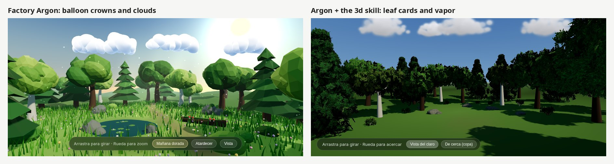

# Antigravity Skills

<p align="center">
  <em>Measured skills for the Antigravity CLI (<code>agy</code>), rebuilt for Gemini 4 Argon.</em>
</p>

## Why so few now

This repo used to ship six skills (code review, git hygiene, React hygiene, unit testing,
web 3D, web frontend) tuned for Gemini 3.x. When **Gemini 4 Argon** came out (October 2026)
I ran each job again on a factory `agy`. Argon does most of what those skills enforced
on its own, so they now cost context and change nothing:

| Old skill | Argon without it |
|---|---|
| `code-review` | Found all 8 planted bugs (SQL injection, IDOR, path traversal, `except: pass` returning `True`, hardcoded key, password in logs…), ran a function to confirm one, didn't touch the code |
| `unit-testing` | Its tests catch all 4 planted bugs (6 red) and all 12 pass on the fixed code: no bugs locked in as "expected" |
| `react-hygiene` | `AbortController`, derived state without `useEffect`, keys by `id`, labeled inputs, compiles |
| `git-hygiene` | Two lines in the rules file are enough |
| `web-3d` | Already gets sRGB, shadows and pixel ratio right |

They are still in the git history. What Argon still gets wrong is **taste**, and that is
what's left here.

## Skills

| Skill | What it fixes |
|---|---|
| [`web`](web/SKILL.md) | **Pages that don't look AI-made.** A die picks style, hero, signature and typefaces; the default anatomy is a full-screen photo with small glass widgets on top and photo-first cards; a linter (`revisa.py`) catches split heroes, colored headline words (also through classes and linked CSS), rows of stats, glows, stock phrases, default fonts, fake "live" data, GPS coordinates and made-up addresses. `foto.py` compresses generated photos. |
| [`3d`](3d/SKILL.md) | **Trees and clouds that aren't balloons.** Argon builds crowns from flat-shaded icosahedra, clouds from stuck-together spheres and rocks that crack open. `vegetation.js` gives real leaf-card crowns with volume normals, sun-shaded vapor clouds and crack-free rocks with fracture faces; `inline.py` embeds it so the page still opens on double click. |
| [`blender`](blender/SKILL.md) | The Blender MCP traps that crash a low-VRAM laptop: how to start it, asset resolution, a render setup that doesn't run out of GPU memory. |



*"A forest clearing with a few trees and clouds in three.js." Left: factory Argon. Right:
Argon with `3d`. The skill also tells it to keep the rest of the scene (grass, water,
light) as rich as without it: the right-hand run was sparser, which is fixed in the skill
but not re-measured.*

Visual checks use `agy-ver` from
[a-gemini-more-like-claude](https://github.com/iaguito22/a-gemini-more-like-claude), and
the six-prototype skill lives in [ai-prototypes](https://github.com/iaguito22/ai-prototypes).

## Installation

```bash
git clone https://github.com/iaguito22/antigravity-skills.git /tmp/antigravity-skills
cp -r /tmp/antigravity-skills/{web,3d,blender} ~/.gemini/config/skills/
rm -rf /tmp/antigravity-skills
```

Python for the scripts; Pillow for `foto.py`. Applies on the next `agy` session.

The history of how these were measured is in [`DEVLOG.md`](DEVLOG.md).
