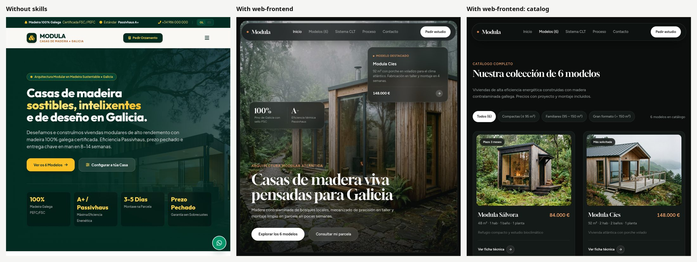

# 🚀 Antigravity Skills

<p align="center">
  <em>A collection of ultra-optimized, stress-tested skills to guide AI agent behavior within the <a href="https://github.com/google/antigravity">Antigravity</a> framework.</em>
</p>

## ❓ Why use these skills?
Large Language Models (LLMs) have bad habits. They love to write legacy CSS, abuse `useEffect` in React, create massive unreadable Git commits, and blindly patch bugs without instrumenting them first. 

These skills act as **mechanical stops and guardrails**. They have been kept compact, refined, and iteratively stress-tested against the same tasks with and without them to force the AI to be efficient, methodical, and safe. 

> 🔬 **Empirical Research:** You can read the scientific history of our stress tests, token costs, and how we solved "LLM disobedience" in the [`DEVLOG.md`](DEVLOG.md).

## 📊 Measured, not claimed

Same prompts, same model (Gemini 3.7 Flash Low, Antigravity CLI 1.2.11), run on 27/09/2026 with the skills installed and with a factory `agy`.



*"Hazme una web para Modula, una empresa gallega de casas modulares de madera. Tienen 6 modelos." Left: factory agy. Center and right: with `web-frontend`.*

| Task | Without skills | With skills |
|---|---|---|
| **Website** (above) | 1 page, 4 linter warnings (colored headline word, stock phrase, fake "live" data, img without size), never opened in a browser | 4 pages (home, catalog with working filters, product page, contact), 8 generated photos, linter clean, opened and checked |
| Output tokens | 81,002 | **36,896 (−54 %)** |
| Time | 213 s | 629 s (the extra time is 8 `generate_image` photos and the visual checks) |
| **Unit tests** for a module with an SQL injection and an off-by-one page bug | 12 green tests, 100 % coverage, **both bugs locked in** as expected behavior | 11 tests, **5 red: both bugs exposed** |
| Time · output tokens | 47 s · 6,795 | 50 s · 8,776 |

The web run is the interesting one: thinner pages rendered from one `data.js` and a single shared stylesheet mean the agent writes **half the code** for a site four times bigger.

## 🛠 Available Skills

### 🛡️ Backend & DevOps
| Skill | Primary Goal |
|-------|--------------|
| [`code-review`](code-review/SKILL.md) | Hunts real breakages, silent failures (`except: pass`) and security holes (SQLi, path traversal, secrets, IDOR). **Runs the suspicious code** before judging instead of just reading it. |
| [`git-hygiene`](git-hygiene/SKILL.md) | **Forbids `git add .`**. Atomic, conventional commits in the repo's language; flags unversioned `.env` files; never pushes unasked. |
| [`unit-testing`](unit-testing/SKILL.md) | Errors and limits first, happy path last. If a test exposes a real bug, it reports it instead of "fixing" the test. |

### 🎨 Frontend & UI/UX
| Skill | Primary Goal |
|-------|--------------|
| [`web-frontend`](web-frontend/SKILL.md) | **Art direction so pages don't look AI-made.** A die picks style, hero, signature and typefaces; the default anatomy is a full-screen background photo with widgets on top, a minimal catalog and photo-first product cards, built as a real multi-page site; `generate_image` supplies the photos and `foto.py` compresses them; a linter (`revisa.py`) catches split heroes, colored headline words, rows of stats, glows, stock phrases, default fonts, fake "live" data, heroes without a background photo and cards without photos. Also modern CSS and accessibility. |
| [`react-hygiene`](react-hygiene/SKILL.md) | **Prohibits deriving state with `useEffect`** (the most common AI React anti-pattern), stable keys, no gratuitous memoization. |
| [`web-3d`](web-3d/SKILL.md) | Fixes plastic-looking WebGL scenes: ACESFilmic, sRGB, shadow-camera framing and fill light in Three.js and R3F. |

Visual checks use `agy-ver` from [a-gemini-more-like-claude](https://github.com/iaguito22/a-gemini-more-like-claude).

*(Note: The `prototypes` skill is maintained in its own repository: [ai-prototypes](https://github.com/iaguito22/ai-prototypes)).*

## 🚀 Installation

The structure of this repository exactly matches what Antigravity expects. 

Clone the repository and copy **only the skill directories** to your local Gemini config:

```bash
git clone https://github.com/iaguito22/antigravity-skills.git /tmp/antigravity-skills
cp -r /tmp/antigravity-skills/*/ ~/.gemini/config/skills/
rm -rf /tmp/antigravity-skills
```

Or, clone it permanently and symlink it (recommended for easy updates):
```bash
git clone https://github.com/iaguito22/antigravity-skills.git ~/antigravity-skills
ln -s ~/antigravity-skills/*/ ~/.gemini/config/skills/
```
